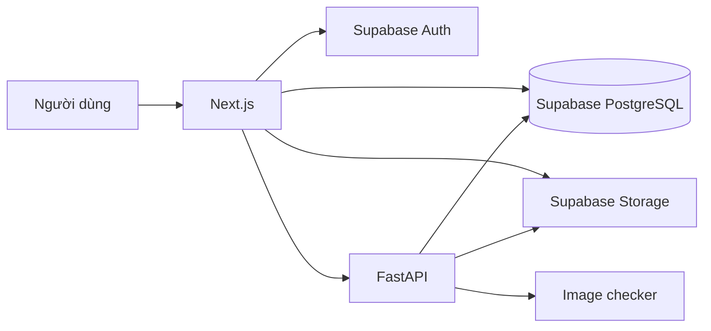
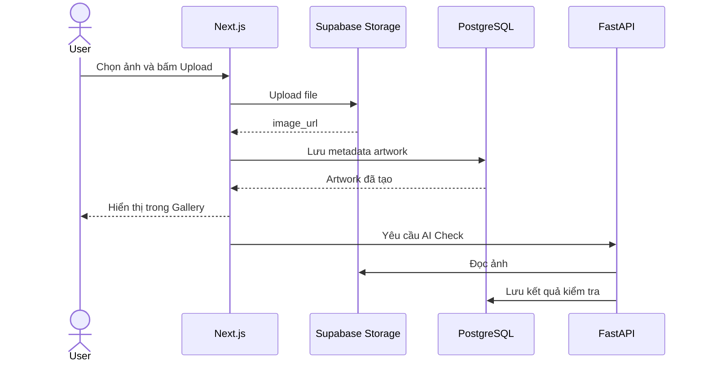

# AC-003 - Kiến trúc hệ thống

## Thành phần

### Next.js

- Đăng ký và đăng nhập.
- Gallery cá nhân.
- Canvas.
- Upload ảnh.
- Gọi FastAPI.

### Supabase

- Auth: email, password, JWT và session.
- Database: profiles, artworks, canvases, canvas_items, image_features và
  image_check_results.
- Storage: lưu file ảnh.

### FastAPI

- Nhận yêu cầu kiểm tra ảnh.
- Đọc ảnh từ Storage.
- Trích xuất đặc trưng và chạy kiểm tra.
- Ghi kết quả về PostgreSQL.

## Luồng upload

