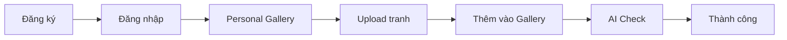
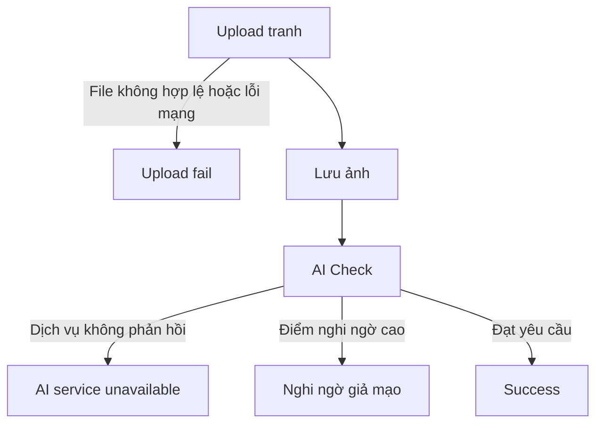

# AC-002 - User flow

## Luồng chính

## Nhánh ngoại lệ

## Tiêu chí hoàn thành

- Người chưa đăng nhập không truy cập được gallery cá nhân.
- Upload thành công phải tạo bản ghi artwork.
- Lỗi upload phải có thông báo rõ ràng và cho phép thử lại.
- AI lỗi không được làm mất ảnh đã upload.
- Kết quả nghi ngờ phải được lưu lại để người dùng xem.

